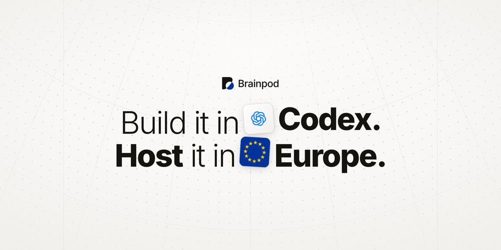
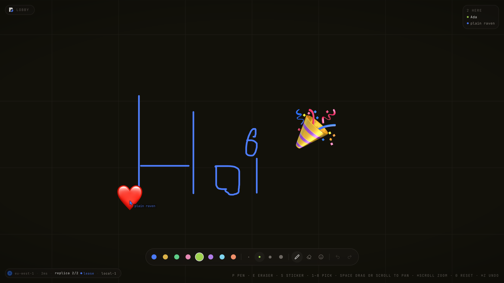
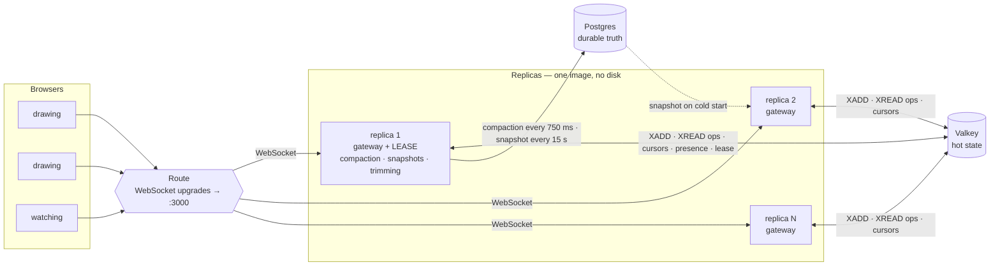
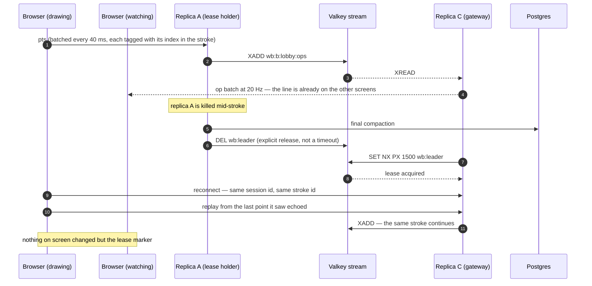

<picture>
  <source media="(prefers-color-scheme: dark)" srcset=".github/hero-dark.gif">
  
</picture>

# Brainpod Whiteboard

A real-time collaborative whiteboard, built to be deployed on [Brainpod](https://brainpod.io).
Next.js on the front, a WebSocket runtime on the back, Postgres for the boards and
Redis for presence and fan-out across replicas.

No signup, no cookie banner — open the link, pick a colour, draw. Everyone on the
link sees every stroke land in real time.

## Deploy it yourself

Clone this repository, open your coding agent in it, and paste:

```
Install the Brainpod skill from github.com/brainpodnl/skills and use it to deploy my project to Brainpod.

Read AGENTS.md first, then sign me up using the Brainpod skills, work out what the project needs, and hand me the live URL when it's up.
```

The skill signs you up, reads the project, provisions it, and hands back a live
URL. `AGENTS.md` states the parts a deploying agent cannot infer from the source
— the port and readiness path, the resource graph, which resources take a disk
and which must not, and how the two databases' connection details reach the App.
Schema migrations run at boot under a Postgres advisory lock, so every replica
can start at once: there is no init container and no migration job.

Every size in `AGENTS.md` is the smallest the API accepts — a `.25x` app on one
replica, `.5x` Postgres and Valkey, 5 GB disks — so a fresh clone-and-deploy
fits in a trial account. One thing is traded for that: Brainpod rejects more
than one replica below `1x`, so the deployed board runs a single replica and the
failover story is not live on it. It costs nothing to see anyway — the local
cluster below runs two replicas — and `AGENTS.md` has the scale-up and, more
importantly, the scale-back-down.

The image is built for the cluster's `linux/amd64` while the compile stages stay
on the host's own architecture, because `next build` and `tsc` emit
platform-independent JavaScript. On an ARM Mac that keeps everything but the
runtime dependency install off the emulator: a redeploy with no source change
takes **0.55 s**, and one after an edit **5.1 s**.



## What it proves

| Brainpod claim | What demonstrates it |
|---|---|
| **Managed Postgres** | Durable truth, and nothing else. Committed strokes (points packed as `uint16` pairs into a `bytea`), deletions, the compaction cursor, and a packed board snapshot rewritten every **15 s**. Close every tab, come back hours later, the board is intact. |
| **Managed Valkey** | All hot state: a Redis Stream per board is both the in-flight op log and the fan-out mechanism, alongside live cursors, presence (**8 s** TTL), the leader lease and the replica roster. Nothing transient ever touches Postgres. |
| **Many replicas** | Ops do not round-trip through a leader. Any replica validates a client op and `XADD`s it to the board stream; every replica tails that stream and flushes batched binary frames to its own sockets at **20 Hz**. The stream's total order is why every screen shows the same board in the same z-order. Needs more than one replica to watch: the two-replica cluster below, or a pod raised to `1x` first. |
| **Zero-downtime deploys** | One replica holds a **1500 ms** Valkey lease, renewed every **500 ms**, and owns only the work that must not run twice: compaction, snapshotting, stream trimming, presence pruning. Measured on the local two-replica cluster below: a drained replica releases the lease explicitly and a successor has it **~0.6 s** later; a hard `kill -9` waits the lease out at **~2.0 s**. Neither pauses drawing for anyone, because neither drawing nor fan-out involves the leader — all that moves on screen is the lease marker in the corner badge. |
| **Stateless containers** | The App mounts no disk — which is also why it can be scaled at all. Ops are already in the stream as the line is being drawn, so a client whose gateway disappears reconnects to another replica with the same session id, the same stroke id, and replays only the points the socket never took. Killing the replica under a pen that is still moving, repeatedly, ends with the observer on the surviving replica holding **every point, once, in order** — measured on the same local two-replica cluster. |
| **EU hosting** | The badge names the region and your round-trip time. The only user input is a display name and where you drew. |
| **Per-second billing** | A binary wire protocol for everything high-rate — snapshots, op batches, cursors — and JSON only for control messages. Clients batch pointer samples every **40 ms**; replicas coalesce and flush every **50 ms**; the leader drains the op log into Postgres every **750 ms** and trims the stream to **120 s**. |

## Architecture



**Every replica writes to the stream; only the lease holder writes to Postgres.**
A gateway reads Postgres only to hydrate a board it has not seen — one snapshot
row plus a short stream replay. A replica that loses Valkey and comes back
resumes from its own stream cursor instead.

The diagram is the shape at N replicas. A trial-sized deploy runs the leftmost
one only — same code, same lease, same paths through Valkey and Postgres — and
the local cluster below runs two.

### A stroke that outlives its replica



The stroke never depended on the replica that was carrying it: the points were
durable in the stream and drawn on every other screen before the socket died.
Because every point batch carries its index within the stroke, a replay that
overlaps what the dead replica already wrote is discarded identically by every
replica, so the line cannot double back on itself. Killing the lease holder is
quieter still — drawing and fan-out never involved it.

To run this exact sequence rather than read it, use the local cluster below —
it has the two replicas the trial-sized pod does not.

## Local development

```
docker compose --profile cluster up --build
```

brings up Postgres, Valkey, two replicas and Caddy in front of them, so a
failover can be rehearsed offline: kill whichever replica holds the lease and
watch the badge, not the board. This is also the free way to see the
multi-replica rows in the table above, which a floor-sized pod cannot show.

For a single process against a local Postgres and Valkey, set `DATABASE_URL` and
`REDIS_URL` in `.env` and run:

```
npm run dev
```
